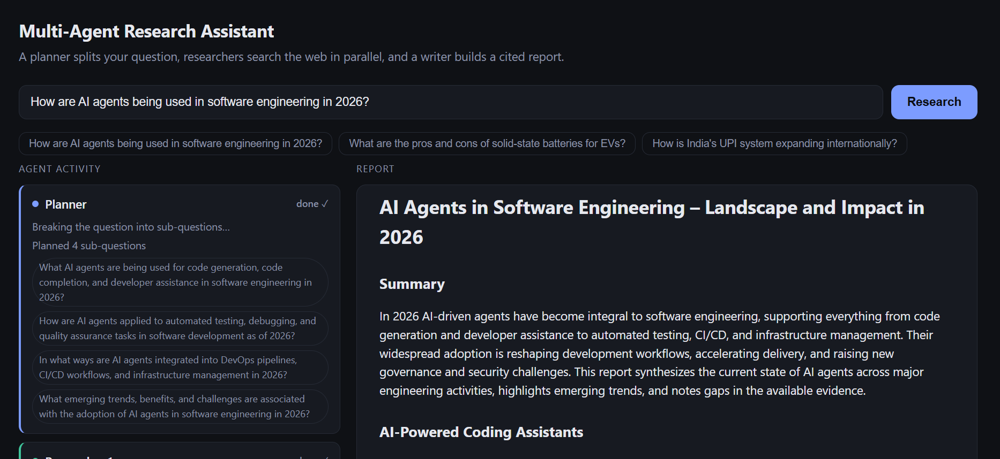
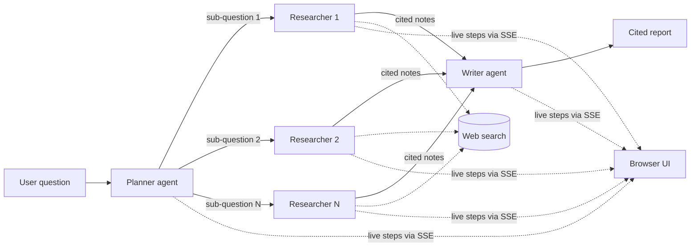
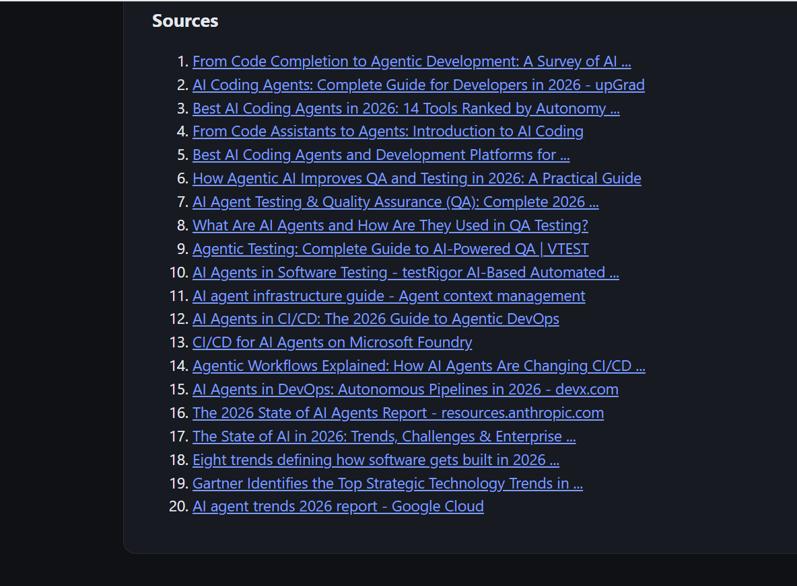

# Multi-Agent Research Assistant

Ask a question and a small team of AI agents researches it for you:

1. **Planner agent** splits the question into focused sub-questions.
2. **Researcher agents** (one per sub-question, running **in parallel**) search the web and write cited notes.
3. **Writer agent** merges every note into one Markdown report with numbered citations and a sources list.

The web UI shows each agent's steps **live** while they work, streamed from the server with Server-Sent Events.



## Architecture



| Layer | Tech |
|---|---|
| Agent orchestration | **LangGraph** `StateGraph`, parallel fan-out with the `Send` API, custom stream events |
| LLM | Any OpenAI-compatible provider: **Groq** (default), **Gemini** fallback, Ollama, Claude, OpenAI |
| Web search | **DuckDuckGo** (no key) or **Tavily** |
| API | **FastAPI** + Server-Sent Events |
| Frontend | Single HTML page, vanilla JS, `EventSource`, Markdown rendering |
| Tests / CI | pytest (offline mock mode) + GitHub Actions |

## Engineering details worth noting

- **True parallelism:** the planner's output fans out to N researcher nodes with LangGraph's `Send`; their results merge through an `operator.add` reducer before the writer runs.
- **Citation integrity:** each researcher cites its own results as `[1]`, `[2]`…; before writing, the app gives every unique URL one global number and rewrites the notes. Any citation number the writer invents is stripped, and the sources list is built by code, not by the model, so every link is real.
- **Model fallback:** if the main model fails (for example a free-tier rate limit), the call retries on the fallback provider automatically.
- **Provider-agnostic:** swapping Groq for Claude or a local Ollama model is a one-line `.env` change.
- **Mock mode:** runs the whole graph with a fake LLM and fake search, so tests and CI need no API keys.


## Run it locally

```bash
git clone https://github.com/gideonswer/multi-agent-research.git
cd multi-agent-research
python -m venv .venv && source .venv/bin/activate   # Windows: .venv\Scripts\activate
pip install -r requirements.txt
cp .env.example .env        # then paste your free GROQ_API_KEY (and GEMINI_API_KEY for fallback)
uvicorn app.main:app --reload
```

Open http://localhost:8000.

No keys yet? Set `MOCK_MODE=true` in `.env` to see the UI and agent flow with fake data.

Run tests:

```bash
pytest -q
```

## API

| Endpoint | Description |
|---|---|
| `GET /` | Web UI |
| `GET /health` | Current provider settings |
| `GET /api/research?q=...` | SSE stream of `step` events, then one `report` event, then `end` |

Example event:

```json
{"type": "step", "agent": "researcher-2", "status": "progress", "message": "Found 5 sources, reading…", "sources": [...]}
```

## Project structure

```
app/
  config.py   settings from .env
  llm.py      OpenAI-compatible client for every provider + fallback
  search.py   DuckDuckGo / Tavily search tools
  graph.py    the agents and the LangGraph workflow
  main.py     FastAPI server + SSE streaming
  mock.py     offline fake LLM/search
static/index.html   live agent UI
tests/              end-to-end tests (mock mode)
```

## Ideas for next steps

- A **critic agent** that checks the report against the notes and sends weak sections back for more research (a loop in the graph).
- Fetch full page text for the top results instead of only search snippets.
- Save reports to SQLite and add a history page.
